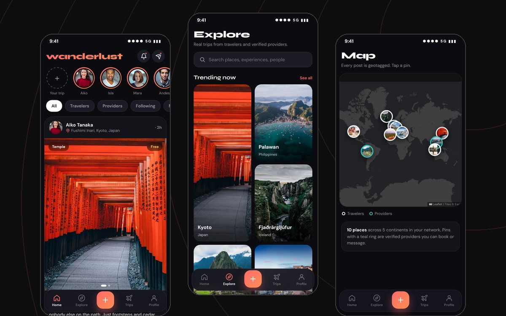
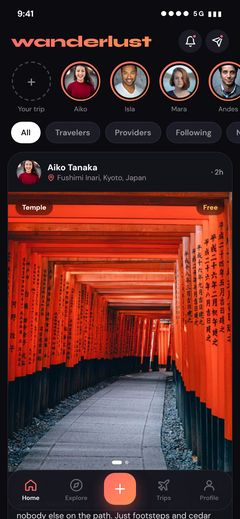
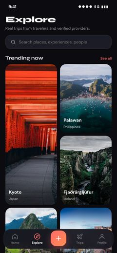
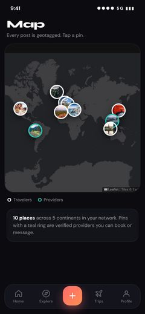
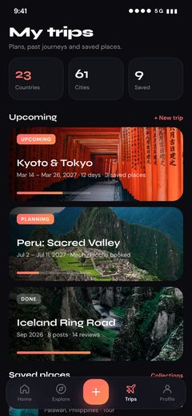
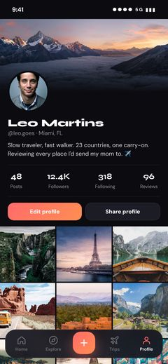
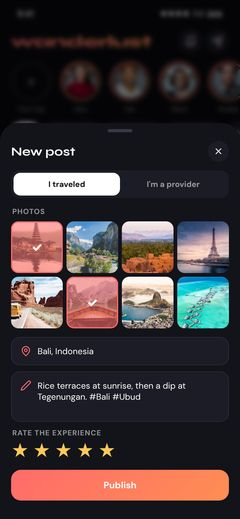
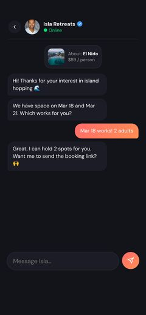
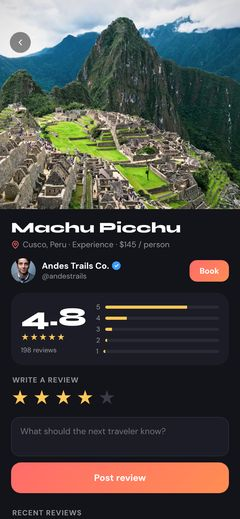

# Wanderlust

A travel social app prototype that mixes Instagram-style trip sharing with TripAdvisor-style reviews. Travelers post where they went and rate it; tour operators, hotels and guides post what they offer and take bookings in the app.

- **Try it:** https://www.wendelfreitas.com/wanderlust/app/
- **Case study:** https://www.wendelfreitas.com/wanderlust/

## Features

- Feed with stories, traveler/provider filters, swipeable photo posts and double-tap to like
- Every post carries a geotag, category, price level, star rating and a short review
- Explore with live search, a trending grid and top-rated experiences
- Map of geotagged posts (Leaflet, Esri dark tiles), with providers marked in teal
- Create a post: traveler or provider, photos, location, caption with #tags, rating
- Direct messages that attach the post as context, with simulated replies
- Place detail with rating distribution, write-a-review and recent reviews
- Save, share sheet, trips with progress, profile and activity notifications
- Booking flow for provider experiences: date picker with availability, time slots, guests, add-ons, live price breakdown, traveler details, payment choice and a confirmation with a booking code
- Bookings land in My trips with their own page (meeting point, message host, cancel) and the host confirms in chat
- Trip pages with itinerary, new-trip creation, collections, place pages, story viewer, profile editing, Explore filters and "See all"

## Screens

| Feed | Explore | Map | Trips |
|---|---|---|---|
|  |  |  |  |
| **Profile** | **New post** | **Messages** | **Reviews** |
|  |  |  |  |

## What is in here

| Path | Contents |
|---|---|
| `app/index.html` | The core app: one HTML file, no framework, no build step. |
| `app/wl-plus.js` | Booking flow and the extra pages (trips, collections, places, stories, profile editing), loaded after the core app. |
| `docs/` | Screenshots, thumbnails and the cover image. |
| `site/case-page.html` | The portfolio case study page. |
| `scripts/shoot.py` | Playwright script that renders the screenshots. |

## Running

Open `app/index.html` in a browser (keep `wl-plus.js` next to it). URL options:

- `?screen=explore` (also `map`, `trips`, `profile`, `create`, `chat`, `detail`, `inbox`, `notif`, `book`, `trip`) opens a given screen
- `?embed` for use inside an iframe, `?bare` for a full-bleed phone view

All content is sample data and nothing is saved. Photos are from [Unsplash](https://unsplash.com).

Designed and directed by Wendel de Freitas; written with Claude.
